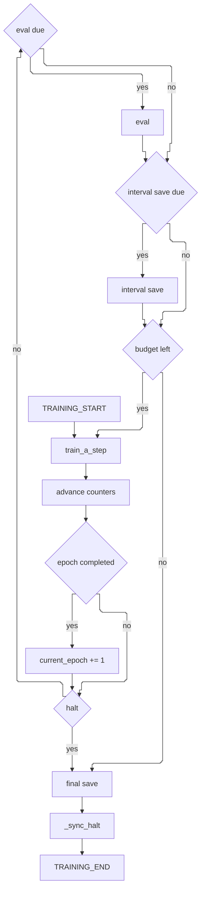
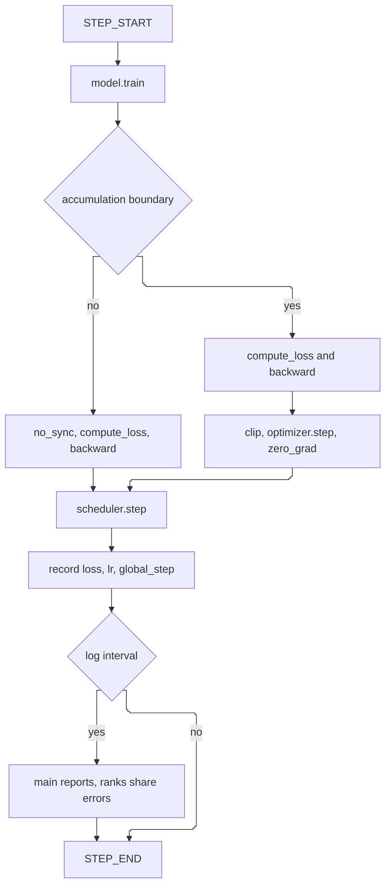
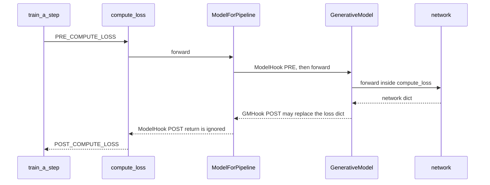
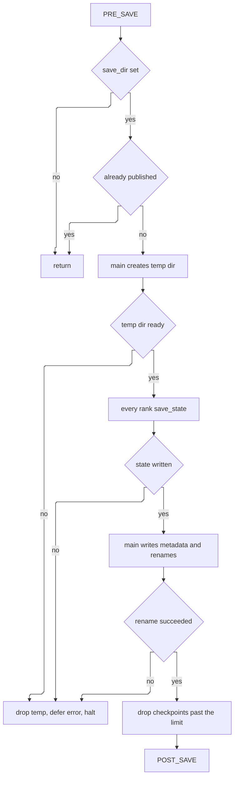

# Training

Every example enters training through `run_experiment`. That function builds the model, the datasets, the optimizer, and the scheduler, then trains a `MyDistributedPipeline`. `get_train_class` returns that class together with `MyTrainingConfig`. One process still constructs an `Accelerator`.

The loop is the same for EDM, flow matching, VAE, and GAN. The module inside `ModelForPipeline` is what changes. Its `forward(**batch)` returns a tensor, or a dict that contains `loss`.

## Two clocks

`train_strategy` chooses which loop runs. Both clocks share the shape below: one batch, then the counters, then eval and an interval save when that clock is due. The loop always calls `save()` on the way out, then `_sync_halt`, then `TRAINING_END`.

- __Epochs__

    ---

    `BasePipeline.train` walks `n_epochs` and skips epochs already stored in `current_epoch`. A finished epoch increments `current_epoch`, and only then can an epoch interval match. The batches inside the epoch still eval and save on the step clock.

- __Steps__

    ---

    `MyDistributedPipeline.train` pulls batches from an infinite iterator until `n_steps`. Only the step clock runs, plus the final save. With `save_strategy` or `eval_strategy` set to `epochs`, those interval checks never run.

`train_a_step` returns before any of those checks. On the epoch clock, the step interval is tested inside the epoch, while `current_epoch` still names the epoch in progress. The epoch interval is tested after a completed epoch increments that counter. A halt during eval or during an interval save leaves the loop the same way, and the final save still runs. An empty `save_dir` makes `save()` return immediately.

## Counters and resume

`TrainingState` keeps three counters.

| Counter | When it moves | When it resets |
| --- | --- | --- |
| `current_global_step` | After each `train_a_step` | Stays for the run |
| `current_step_in_epoch` | After each `train_a_step` | Returns to 0 when the epoch completed |
| `current_epoch` | After a completed epoch, in `train` | Stays for the run |

On the step clock, `current_step_in_epoch` keeps growing and `current_epoch` stays at the value loaded with the run. Checkpoint names from that clock therefore carry epoch 0 unless a checkpoint restored another epoch.

An epoch resume skips epochs below `current_epoch` and passes `current_step_in_epoch` to `skip_first_batches`. A step resume uses `current_global_step % len(dataloader)` as the offset of an infinite iterator. `prepare` wraps the model, optimizer, dataloader, and scheduler before `load`, so the checkpoint restores those wrapped objects. The latest directory is the `checkpoint_*` name with the largest `global` number.

`load` reads `training_state`, `training_config`, and `log_config`. The pipeline then puts the `training_config` from this process back in place. The loaded training state and log config stay.

!!! note "Intervals read the updated counters"
    A step interval matches when `current_global_step` is positive and divisible by `save_steps` or `eval_steps`. An epoch interval matches when `current_epoch` is positive and divisible by `save_epochs` or `eval_epochs`. Those helpers already see the incremented values.

A training log uses the counter from before that increment. The due check adds one, so with `log_steps: 1` the first batch is reported as step 0. Eval runs after the increment, so the eval report for that same batch uses a global step one higher. An epoch log, after a completed epoch whose epoch interval is due, reports the last batch at the `current_epoch` value from before `train` increments it. The main process writes the report. Every rank shares a deferred reporter error at the same point.

## One step

`DistributedPipeline.train_a_step` is the step examples run. Eval and saving stay in the loop above.

The boundary is `(current_global_step + 1) % gradient_accumulation_steps == 0`, using the counter from before this batch is counted. On that boundary the step keeps gradient sync, clips, calls `optimizer.step`, and zeroes the gradients. `grad_clip_strategy` selects a norm clip or a value clip. `None` skips the clip, and the optimizer still steps. Off the boundary the step wraps the loss in `accelerator.no_sync` and leaves the optimizer alone.

`accelerator.backward` scales the loss by the accumulation steps. `BasePipeline.train_a_step` divides the loss itself and calls `loss.backward`. Examples go through `DistributedPipeline`.

When a scheduler is attached, the pipeline calls `scheduler.step()` on every micro-step. The Accelerate wrapper advances the inner scheduler only when gradients just synced. This project leaves `split_batches` at `False`, so that synced call advances the inner scheduler `num_processes` times. The length of the schedule is described in [Learning rate](learning-rate.md).

The recorded `global_step` is the pre-increment counter. On a step log interval the main process reports `loss`, `lr`, and that `global_step` when it has a logger. Every rank then shares a deferred reporter error.

## Where the loss comes from

`MyDistributedPipeline.compute_loss` is what the step and eval both call. The pipeline asks the wrapped module for a loss. EDM's sampling and weighting happen inside that module, in `compute_loss`, and are one implementation of this call.

### Pipeline callbacks

A callback sees the lifecycle: the batch, the configs, the training state, the model, the optimizer, the scheduler, and, on the distributed pipeline, the accelerator. `compute_loss` still returns the dict from the module. `PRE_COMPUTE_LOSS` and `POST_COMPUTE_LOSS` also run during eval. The eval call sets `phase` to `eval` and `can_log` to false.

### Model hooks

`ModelForPipeline` runs `ModelHook` stages around the inner module. `PRE_COMPUTE_LOSS` sees the batch before that module. `POST_COMPUTE_LOSS` sees `model_output` after it. The wrapper returns the inner dict. A hook can mutate that dict in place. The VAE KL anneal hook and the GAN metrics hook are this kind of hook.

### Generative-model hooks

A `GMHook` lives on the generative model. After `compute_loss`, `BaseGenerativeModel.forward` runs `POST_COMPUTE_LOSS` and, when the hook returns a dict or a tensor, uses that return value as the forward result. Sampling hooks use other stages and stay out of this training call.

### EDM

The butterfly and moon EDM examples hand the diffuser a batch with `gt_data` and `padding_mask`. `EuclideanEDMDiffuser.compute_loss` samples `x_t` and `sigma`, runs the network, and reads `x`. The weighted error uses

\[
\lambda(\sigma) = \frac{\sigma^2 + \sigma_{\mathrm{data}}^2}{(\sigma \, \sigma_{\mathrm{data}})^2}
\]

A conditional run rewrites that loss in the diffuser's `POST_COMPUTE_LOSS` hook.

## Evaluation

`BasePipeline.eval` is empty. `MyDistributedPipeline.eval` is the eval the clocks call. It emits `PRE_EVAL`, switches the model to eval, and runs `compute_loss` on each eval batch with `phase="eval"`. Each batch emits `PRE_EVAL_STEP` and `POST_EVAL_STEP`.

The scalar loss is repeated across the batch dimension and passed to `gather_for_metrics`, so the last incomplete shard is trimmed before the mean, max, min, and standard deviation. An empty loader yields NaN for each of those four. The main process reports them at the current global step, which the training loop has already incremented. The method then switches the model back to train, shares a deferred error, and emits `POST_EVAL`.

## Checkpoints

Distributed save publishes one directory only after every rank has written.

The published name is `checkpoint_epoch{epoch}_step{step}_global{global_step}`. Accelerate writes `model.safetensors` by default. The main process also writes `training_state.pth`, `training_config.pth`, `log_config.pth`, and, when a reporter is open, `report_run.json`. A failure deletes the temp directory, remembers the error, and sets halt on every rank. The published directory is left as it was. `POST_SAVE` runs after the rename. An empty `save_dir`, an existing directory, or an abort returns after `PRE_SAVE` only.

`save_total_limit` drops the oldest checkpoints by the `global` number in the name. A failure there is logged, and `POST_SAVE` still runs. The training loop calls this save at an interval and again when the loop returns, including after a halt. `BasePipeline.save` writes whole objects with `torch.save`. Examples use the distributed writer above.

## Halt

A reporter failure on the main process is remembered and shared on a log interval, after eval, and after the loop. A failed save halts every rank and leaves any published checkpoint in place. `TRAINING_END` still runs after the final save and `_sync_halt`.

!!! note "A halted epoch stays open"
    A halt inside the step loop leaves the epoch unfinished. `current_epoch` stays, and `current_step_in_epoch` stays on the next batch. Resume continues from those counters. The final save and `TRAINING_END` still run.

When the loop returns, every rank runs `after_train_fn` when the pipeline has not halted. All ranks then destroy the process group. A deferred error is raised before the main process runs `post_train_fn`. An exception in training or in `after_train_fn` destroys the group and skips `post_train_fn`.

## Callbacks

`CallbackManager` runs every callback, in registration order, with the training config, log config, training state, logger, model, dataloader, optimizer, and scheduler. The distributed pipeline also passes the accelerator. The event's own keyword arguments are listed below.

| Event | When it runs |
| --- | --- |
| `TRAINING_START` | Entering `train` on either clock |
| `EPOCH_START` | Entering `train_an_epoch`. The step clock does not emit it |
| `STEP_START` | Entering `train_a_step`, with `batch` |
| `PRE_COMPUTE_LOSS` | In `compute_loss`, before the forward, in train and eval |
| `POST_COMPUTE_LOSS` | After the forward, with `batch`, `loss`, `model_output`, `phase`, and `can_log` |
| `PRE_BACKWARD` | Before `accelerator.backward` |
| `POST_BACKWARD` | After `accelerator.backward` |
| `PRE_OPTIMIZER_STEP` | On an accumulation boundary, before `optimizer.step` |
| `POST_OPTIMIZER_STEP` | On that boundary, after `optimizer.step` and before `zero_grad` |
| `STEP_END` | Leaving `train_a_step`, with `batch`, including when the step halted |
| `EPOCH_END` | Leaving `train_an_epoch`, including when the epoch did not finish |
| `PRE_EVAL` | Start of `eval`, with `eval_dataloader` |
| `PRE_EVAL_STEP` | Before one eval batch |
| `POST_EVAL_STEP` | After one eval batch, with `result` and `loss` |
| `POST_EVAL` | After the gathered metrics, with `eval_results` |
| `PRE_SAVE` | Start of `save`, before any early return |
| `POST_SAVE` | After the temp directory is renamed into place |
| `PRE_LOAD` | Start of `load` |
| `POST_LOAD` | After checkpoint files are applied |
| `TRAINING_END` | After the final save and `_sync_halt`, including when the loop halted |

`POST_SAVE` is absent when `save_dir` is empty, when the directory already exists, or when the publish aborts. `POST_LOAD` is absent when no checkpoint is found. `PRE_OPTIMIZER_STEP` and `POST_OPTIMIZER_STEP` run only on an accumulation boundary.

## Config fields that move these clocks

Signatures live in the [pipeline API](api/pipeline.md). The fields below are the ones the figures depend on.

| Field | What it changes |
| --- | --- |
| `train_strategy` | Epoch loop or step loop |
| `n_epochs` | Length of the epoch loop |
| `n_steps` | Length of the step loop, per rank |
| `gradient_accumulation_steps` | Batches between optimizer steps |
| `real_batch_size` | When set, accumulation becomes this size divided by the process count and the per-device batch size |
| `save_strategy`, `save_steps`, `save_epochs` | Which clock saves, and how often |
| `save_dir` | Directory of `checkpoint_*` folders. Empty skips the publish |
| `save_total_limit` | How many checkpoints remain |
| `eval_strategy`, `eval_steps`, `eval_epochs` | Which clock evaluates, and how often |
| `log_strategy`, `log_steps`, `log_epochs` | Which clock reports, and how often |
| `log_dir` | Empty skips a log interval |
| `grad_clip_strategy`, `max_grad_norm`, `max_grad_value` | Clip on an accumulation boundary |
| `mixed_precision` | Passed to the `Accelerator` |

## See also

The [pipeline API](api/pipeline.md) documents the classes. [Learning rate](learning-rate.md) documents why the scheduler length is the per-rank step count times `num_processes`. Sampling and inpainting run in each example's `post_train`, after this loop returns.
